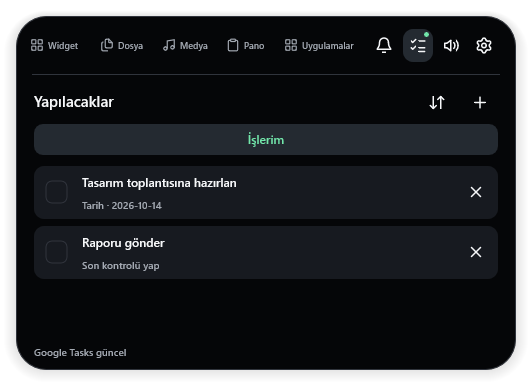

# NativeIsland

Windows için yerel, açık kaynaklı Dynamic Island. C++20, Win32, Direct2D, DirectWrite ve DirectComposition kullanır; Electron veya WebView içermez.

## İndir ve kur

**[NativeIsland-Kurulum.exe indir](https://github.com/ajaroste/NativeIsland/releases/latest/download/NativeIsland-Kurulum.exe)** · [Sürümler](https://github.com/ajaroste/NativeIsland/releases) · [MIT lisansı](LICENSE)

Windows 10 2004 veya daha yeni Windows / Windows 11, x64 gereklidir. Visual C++ runtime ayrıca kurulmak zorunda değildir.

1. Önceki NativeIsland sürümü açıksa sistem tepsisinden **Çıkış** seç.
2. Kurulum EXE'sini normal çift tıklayarak çalıştır.
3. Kurulumda belirtilen **NativeIsland Local Development** sertifikasına güvenme onayını, dosyanın bu depodan geldiğini doğruladıktan sonra ver. Sertifika güveni için Windows yönetici onayı gerekebilir.
4. Başlat menüsünden **NativeIsland**'ı aç. Ada üzerine gelince panel açılır; sağ üstteki dişli **Ayarlar**'ı açar.

**İmzalama durumu:** Bu bir topluluk/önizleme sürümüdür; Microsoft Store yayını veya genel güvenilir yayıncı imzası değildir. MSIX yerel geliştirme sertifikasıyla imzalıdır; kurulum EXE'si genel güvenilir kod imzası taşımaz. Windows yayıncı/SmartScreen uyarısı gösterebilir. Güvenlik korumalarını kapatma. Kurulum yalnızca belirtilen sertifikayı **TrustedPeople** deposuna, açık onayınla ekler; Trusted Root veya genel güvenlik politikalarını değiştirmez. [Kurulum ve güvenlik ayrıntıları](docs/single-file-installer.md).

Sürümler bölümündeki `SHA256SUMS.txt` dosyasıyla indirilen kurulumun bütünlüğünü karşılaştırabilirsin:

```powershell
Get-FileHash .\NativeIsland-Kurulum.exe -Algorithm SHA256
```

## Özellikler

- Kapsül ve damla görünümü, altı tema, ayarlanabilir açılış animasyonları.
- Medya bilgisi, albüm kapağı ve destekleyen oynatıcılarda oynat/duraklat/önceki/sonraki kontrolleri.
- Ana ses ve uygulama bazlı ses mikseri; yıldızlı uygulamalar açıkken başta görünür.
- Dosya rafı: Explorer'dan sürükle, raftan başka konuma sürükleyerek kopyala.
- Uygulama kısayolları ve dört sütunlu ikon görünümü.
- İsteğe bağlı metin/görsel pano geçmişi, arama, sabitleme ve otomatik temizleme.
- Yerel hatırlatıcılar, Dün/Bugün/Yarın geçişi; isteğe bağlı Google Takvim ve Google Tasks.
- Görev listesi çanın yanındaki ikondan açılır. Tamamlananlar gizlidir; yalnızca **Ekle** düğmesi yeni görev gönderir. **×**, onaydan sonra görevi Google Tasks hesabından siler.
- İsteğe bağlı Windows bildirimlerini kısa süreli adada gösterme; ayrı erişim izni gerekir.
- Monitör seçimi, yatay konum, Windows başlangıcında açılma ve gizle/göster kısayolu.



## Google ve bildirim kurulumu

Uygulama Google bağlantısı olmadan da kullanılabilir. Bu sürüm ortak bir Google OAuth istemcisi içermez: her kullanıcı kendi Google Cloud projesinde API'leri etkinleştirip **Desktop app / Masaüstü uygulaması** OAuth JSON dosyasını Ayarlar'dan seçer. API anahtarı veya servis hesabı bu akışın yerine geçmez. Test modundaki projede kendi Google hesabını test kullanıcılarına eklemelisin.

- [Google Takvim kurulumu](docs/google-calendar-setup.md)
- [Google Tasks ve ses mikseri](docs/tasks-and-sound.md)
- [Windows bildirim erişimi](docs/windows-notifications.md)

## Gizlilik ve güncellemeler

Ayarlar, hatırlatıcılar ve bağlantı bilgileri kurulum klasöründen ayrı `%LOCALAPPDATA%\NativeIsland` altında saklanır. Güncelleme bunları silmez. Google yenileme belirteçleri Windows DPAPI ile mevcut kullanıcı için şifrelenir. Google dosyalarını, OAuth JSON dosyalarını ve kişisel kayıtlarını GitHub'a yükleme.

Pano geçmişi varsayılan olarak kapalıdır; açıldığında bellekte tutulur, uygulama kapatıldığında temizlenir. Windows bildirimleri dosyaya kaydedilmez. [Güvenlik yaklaşımı](docs/security.md).

## Kaynak koddan derle

Visual Studio 2022 / Build Tools (**Desktop development with C++**), Windows SDK ve CMake 3.25+ gerekir.

```powershell
cmake --preset vs2022-x64
cmake --build --preset release
ctest --preset release
```

EXE: `out/build/vs2022-x64/Release/NativeIsland.exe`. Paketsiz EXE Windows bildirim dinleyicisine erişemez; bu özellik için imzalı MSIX kurulumu gerekir. Paket üretimi için [dağıtım notlarına](docs/single-file-installer.md) bak; kendi imzalama sertifikan gerekir, özel anahtar depoda bulunmaz.

Yerel otomatik testler ve renderer önizlemeleri doğrulanır. Her Windows/DPI/donanım kombinasyonu, temiz ikinci bilgisayardaki ilk kurulum ve gerçek Google/WhatsApp hesabı senaryoları tamamen test edilmiş değildir. Sorunları [Issues](https://github.com/ajaroste/NativeIsland/issues) üzerinden bildir; günlüklerdeki kişisel bilgileri paylaşmadan önce temizle.

## Son değişiklikler

0.8.7: Public dağıtım için statik Visual C++ runtime ve paket lisansları. Son UI değişiklikleri: tam **Uygulamalar** etiketi; çan yanındaki görev sekmesi; tamamlanan görevleri gizleme; yazarken yanlışlıkla ekleme hatasının düzeltilmesi; onaylı görev silme. [Geliştirme geçmişi](docs/CHANGELOG.md).
